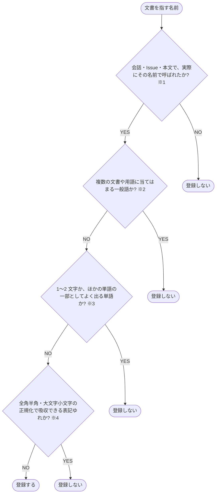

# エイリアスを登録するかを決める

文書を指す名前を、エイリアスとして登録するかを決める判定フローチャート

- **※1 その名前で呼ばれた**: その文書を指す単語として使用された実例が、会話・Issue・本文に残っている。略称・英語名・旧名で参照される場合も含む
- **※2 一般語**: 文書に固有でなく、別の意味の文章でも使用される単語。登録すると、関係ない入力にもその文書の文脈が追加される。例: 設定・手順
- **※3 1〜2 文字の単語・ほかの単語の一部**: [照合](./コアコンセプト-引用の文脈.md#照合) で別の単語の中でも該当する単語。例: 「値」は「価値」に該当する
- **※4 正規化で吸収できる表記ゆれ**: [照合](./コアコンセプト-引用の文脈.md#照合) のそろえ方で同じ単語になる表記の違い。例: 「ＡＰＩ」と「API」は片方だけ登録する
