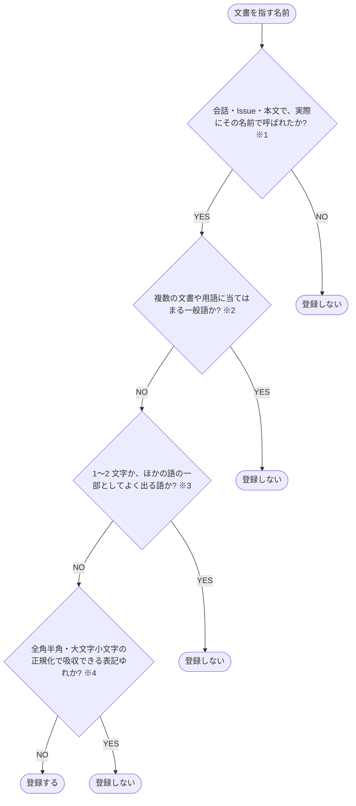

# エイリアスを登録するかを決める

文書を指す名前を、エイリアスとして登録するかを決める判定フローチャート

- **※1 その名前で呼ばれた**: その文書を指す語として使われた実例が、会話・Issue・本文に残っている。略称・英語名・旧名で参照される場合も含む
- **※2 一般語**: 複数の文書や用語に当てはまる語。登録すると、ツールチップが別の文書に紐付く。例: 設定・手順
- **※3 1〜2 文字の語・ほかの語の一部**: [照合](../はじめに/コアコンセプト/引用の文脈.md#照合) で別の語の中でも当たる語。例: 「印」は「印刷」に当たる
- **※4 正規化で吸収できる表記ゆれ**: [照合](../はじめに/コアコンセプト/引用の文脈.md#照合) のそろえ方で同じ語になる表記の違い。例: 「ＡＰＩ」と「API」は片方だけ登録する
